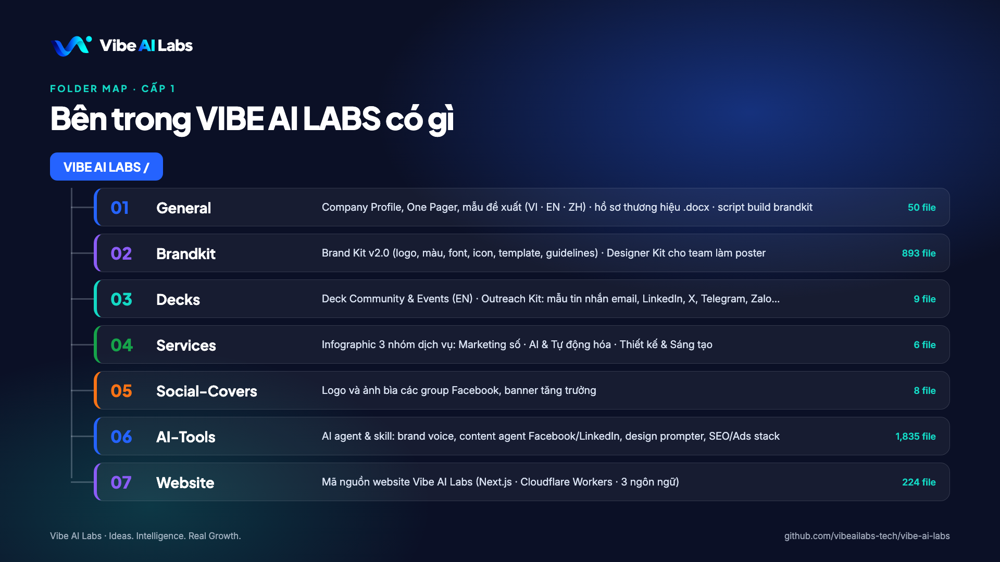

<p align="center">
  
</p>

<h1 align="center">Vibe AI Labs</h1>

<p align="center">
  <b>Marketing × AI × Creative</b><br>
  AI-Powered Growth & Creative Agency<br>
  <i>Ideas. Intelligence. Real Growth.</i>
</p>

<p align="center">
  <a href="https://vibe-ai-labs.vibeailabs.workers.dev">Website</a> ·
  <a href="mailto:vibeailabs@gmail.com">vibeailabs@gmail.com</a> ·
  <a href="https://facebook.com/vibe.ai.labs">Facebook</a> ·
  <a href="https://x.com/vibe_ai_labs">X</a> ·
  <a href="https://github.com/vibeailabs-tech/vibe-ai-labs">Tiếng Việt</a>
</p>

---

This repository is the **master asset hub of Vibe AI Labs**: company profile, brand identity kit, service collateral, website, and the in-house AI agents we use to run Marketing × AI × Creative. The company overview below is based on the [Company Profile (EN)](01_General/01_Company-Profile/Vibe_AI_Labs_Company_Profile_EN.pdf).

> Folder and file names are kept in their original language (mostly Vietnamese) so the structure matches the Vietnamese repository exactly.

## Contents

- [Part A — About Vibe AI Labs](#part-a--about-vibe-ai-labs)
  - [About us](#about-us)
  - [Client challenges](#client-challenges)
  - [Vision, mission, core values](#vision-mission-core-values)
  - [Six differentiators](#six-differentiators)
  - [Three capabilities, 19 service groups](#three-capabilities-19-service-groups)
  - [Technology and platforms](#technology-and-platforms)
  - [How we work](#how-we-work)
  - [Who we serve](#who-we-serve)
  - [Founder and team](#founder-and-team)
  - [Community ecosystem](#community-ecosystem)
  - [FAQ](#faq)
  - [Brand identity](#brand-identity)
- [Part B — Repository structure](#part-b--repository-structure)
- [Part C — Working with this repository](#part-c--working-with-this-repository)
- [Contact](#contact)

---

# Part A — About Vibe AI Labs

## About us

Vibe AI Labs provides **Marketing, Artificial Intelligence (AI) and Creative** solutions for businesses, organizations and individuals in Vietnam.

We connect **strategy, brand, content, communications, technology, data and automation** into one system, instead of treating Marketing, AI and Creative as separate activities.

**Our goal:** not just to work more efficiently, but to build systems that can be measured, optimized, automated and grown over the long term.

| | |
|---|---|
| Headquarters | Ho Chi Minh City — WORC@Q2 Building, 21 Võ Trường Toản, An Khánh |
| Coverage | Nationwide, on-site and remote |
| Working languages | Vietnamese · English · Chinese |
| Main market | Vietnam |

## Client challenges

> Most businesses don't lack tools. They lack a system.

| Marketing | AI & Automation | Creative |
|---|---|---|
| No clear strategy | Not sure where to start with AI | No consistent identity system |
| Fragmented activities that are hard to measure | Lots of repetitive work that relies on manual steps | Hard to produce content at scale |
| High ad costs, low conversion rates | Data scattered across many systems | Production takes a lot of time |
| Inconsistent content | Reporting takes too much time | Need many content variations |
| Customer data is underused | Customer care and sales are not yet automated | Need to streamline image and video production |

## Vision, mission, core values

**Vision** — To be the partner of businesses, organizations and individuals in Vietnam in applying Marketing, AI and Creative to solve real problems. To turn AI from a new technology into a practical, accessible tool that creates clear value in work, business and creativity.

**Mission** — Connect Marketing strategy, AI technology, data, automation and creative capability into solutions that can be implemented in practice:

1. Define the right problem before choosing technology.
2. Apply AI to use cases with real value.
3. Improve Marketing performance and growth.
4. Automate the work and processes that can be optimized.
5. Help teams boost productivity with AI.
6. Turn ideas into solutions, prototypes and products that can be tested.
7. Combine technology with creativity to scale content production.
8. Build systems that can be measured, optimized and scaled.

**Six core values**

| # | Value | Meaning |
|---|---|---|
| 01 | Start from the problem | Understand the problem, the goal and the value the client wants to create — never start from technology or tools. |
| 02 | Real value | A solution only matters when it creates visible improvement in performance, experience, cost or growth. |
| 03 | People and technology together | AI is a tool that extends what people can do, not a full replacement for them. |
| 04 | Creativity with purpose | Creativity serves the brand, the experience, communications and business goals — not just looks. |
| 05 | Measure and optimize | Every solution can be tracked, evaluated and improved based on data and real results. |
| 06 | Keep testing and innovating | Keep experimenting, learning and updating methods to fit each problem. |

## Six differentiators

1. **Connecting Marketing with AI** — Use AI, data and automation to make Marketing faster, more effective and scalable.
2. **Connecting AI with real problems** — Problem → Process → Data → Solution → Technology. Not: Technology → look for somewhere to apply it.
3. **Connecting Creative with technology** — Creative thinking, art direction, traditional production and generative AI.
4. **From consulting to delivery** — With you from discovery and strategy to delivery, measurement, optimization and scaling.
5. **Flexible on technology** — Tools are chosen by the problem, existing systems, data, security, budget and operability.
6. **People at the center** — What people should do, what AI should support, and what can be fully automated.

## Three capabilities, 19 service groups

Fixed order: **Marketing → AI → Creative**.

| Capability | Pillar color | Role | Groups |
|---|---|---|---|
| **Digital Marketing** | Electric Blue `#2563FF` | The foundation for building and growing your presence in the market | 10 |
| **Artificial Intelligence (AI) & Automation** | Green `#16A34A` | Bringing AI into real problems to cut manual work and speed up processes | 4 |
| **Design & Creative Studio** | Orange `#F97316` | Where strategy and ideas become visual experiences | 5 |

### 01 · Digital Marketing (10 groups)

| # | Service group | Flow | Highlights |
|---|---|---|---|
| 01 | Marketing strategy | Research → Customers → Competitors → Strategy → Plan | Market & category research, competitor analysis, personas & segmentation, Marketing/communications/channel strategy, campaign & product launch plans, customer journey, funnel, budget, KPI system |
| 02 | Brand building | Brand strategy → Positioning → Identity → Imagery → Consistency | Brand strategy & positioning, brand architecture, naming, slogan/tagline, messaging, logo, identity system, brand guidelines, sales collateral, company profile, packaging, POSM, refresh & repositioning |
| 03 | Creative & content | Content strategy → Ideas → Message → Design → Image & Video | Content pillars & planning, campaign ideas, copywriting (ads, website, social, SEO), design, short-form TikTok/Reels, ad/corporate/product video, photography, motion graphics |
| 04 | Social media | Channel strategy → Content → Publishing → Engagement → Community | Facebook, TikTok, Instagram, LinkedIn, Zalo OA, YouTube; content calendar, channel management, inbox/comments, seeding, minigames, community management, reporting |
| 05 | Website & digital platforms | Structure → Experience → Design → Development → Conversion | Sitemap, UI/UX, corporate/sales/e-commerce websites, landing pages, microsites, speed & conversion optimization, CRM/chatbot/payment integration, GA4, GTM, app marketing, ASO |
| 06 | Communications & performance marketing | Reach → Traffic → Leads → Conversion → Revenue | Media planning, Meta/Google/TikTok/YouTube/LinkedIn/Zalo Ads, Display, Native, Programmatic, Retail Media, OOH/DOOH, lead gen, retargeting, CPL/CPA/ROAS optimization |
| 07 | SEO & AI-powered search | Search → Visibility → Visits → Content → Conversion | Technical, on-page, off-page, content and local SEO, link building, topic clusters; **GEO / AEO**: optimizing for brand mentions and citations in AI results |
| 08 | PR & influencers | Message → Press → KOL/KOC → Community → Reach & Credibility | PR strategy, press relations, press releases, media booking, executive communications, crisis communications, KOL/KOC, affiliate creators, livestreams, events, workshops, activations, sampling |
| 09 | Data & growth | Measurement → Analysis → Testing → Optimization → Retention → Growth | Tracking, dashboards, funnel & channel analysis, CRO, A/B testing, CRM, lead scoring/nurturing, Email/SMS/Zalo ZNS, marketing automation, retention, loyalty, social listening, share of voice, growth marketing |
| 10 | E-commerce & social commerce | Storefront → Products → Traffic → Conversion → Orders → Revenue | Shopee, Lazada, TikTok Shop, D2C websites; storefront setup & optimization, marketplace ads, affiliate, live-selling, social commerce, ROAS & revenue tracking |

### 02 · Artificial Intelligence (AI) & Automation (4 groups)

Principle: **Problem → Process → Data → Solution → Technology.**

| # | Service group | Highlights |
|---|---|---|
| 01 | AI strategy & consulting | AI readiness assessment, AI opportunity mapping, AI strategy & transformation roadmap, business process assessment, solution design, technology & model selection, AI ROI assessment, AI training for teams |
| 02 | AI automation & AI Agents | Business process automation, document processing, AI Agents and multi-agent workflows, human-in-the-loop review & approval, automation for email/CRM/sales/Marketing/customer care/internal ops/data/reporting |
| 03 | Chatbots & AI assistants | Website/customer-care/sales chatbots, lead qualification bots, internal & personal AI assistants, knowledge-base chatbots, FAQ, RAG, Messenger/WhatsApp/Zalo AI Bots, voice assistants |
| 04 | Content & creative with generative AI | AI copywriting, AI content creation & editing, AI product imagery, AI video, AI avatars, AI voiceover, localization & dubbing, AI music, AI-driven creative campaigns |

### 03 · Design & Creative Studio (5 groups)

Combining art direction, traditional production and generative AI — faster and more varied while staying on-brand.

| # | Service group |
|---|---|
| 01 | Brand identity & logo design |
| 02 | Graphic design & visual communication |
| 03 | Illustration & visual art |
| 04 | Photography & video production |
| 05 | Creation & production with generative AI |

## Technology and platforms

Technology is chosen by the problem, not by the tool.

| Category | Technology |
|---|---|
| AI models | OpenAI, Claude, Gemini, Grok, DeepSeek |
| Automation | n8n, Hermes Agent, Make, Zapier, Webhook, API |
| Marketing & advertising | Meta, Google, TikTok, YouTube, LinkedIn, Zalo, Programmatic Advertising |
| Analytics & measurement | Google Analytics, Google Tag Manager, Looker Studio, conversion tracking, Marketing dashboards |
| CRM & customer care | CRM integration, Email Marketing, SMS, Zalo OA, ZNS, Chatbot, Marketing Automation, customer data management |
| E-commerce | Shopee, Lazada, TikTok Shop, Website, Shopify / Haravan |

**Technology selection criteria:** problem · existing systems · integration · data · security · budget · operations · scalability · return on investment.

> The platforms above are technologies selected per project, not official partners of Vibe AI Labs.

## How we work

### Method: Audit → Build → Automate → Grow

| Step | What it means |
|---|---|
| **01 Audit** | Assess the current state: market, customers, data, processes |
| **02 Build** | Build the foundation: strategy, brand, content, measurement |
| **03 Automate** | Connect systems, AI Agents, chatbots and automated workflows |
| **04 Grow** | Test, measure and optimize against real data |

### From discovery to scale, in 8 steps

```
01 Discovery → 02 Analysis → 03 Strategy → 04 Proposal
→ 05 Implementation → 06 Measurement → 07 Optimization → 08 Scale
```

### Responsible AI delivery

**Don't automate just because you can.** What people should do → what AI should support → what can be fully automated.

1. Start from the problem · 2. Prioritize real value · 3. People in control at key points · 4. Protect data · 5. Choose the right technology · 6. Test before scaling · 7. Make it measurable · 8. Keep optimizing · 9. Don't automate just because you can

**Roadmap for a new AI problem:** Idea → Prototype → PoC → MVP → Implementation → Measurement → Scale.

### Data & security

Client data stays under the client's control.

- **Access by scope** of work and actual need.
- **Use only the data that's needed** for the project scope.
- **Architecture chosen by security requirements** and the client's data policy.
- **Human oversight and approval** — review, approve, adjust and intervene when needed.

### Ways to work together

Project-based · Ongoing retainer (monthly/quarterly) · Consulting · Implementation · Managed operations · Training · Current-state assessment.

No single fixed price. Cost depends on scope, complexity, deliverables, timeline, technology, staffing, infrastructure, integration and post-delivery operations.

### Handover & post-delivery support

- **Handover (depending on scope):** design assets, content, images, video, strategy documents, reports, project data, automation workflows, AI Agents, chatbots, system configuration, accounts & access rights, source code (if within scope), technical/user/operations documentation.
- **Training & transfer:** system walkthrough, administrator and end-user training, AI Agent management, handling common situations, operating process handover.
- **Post-delivery support:** troubleshooting, configuration adjustments, system monitoring, performance & cost optimization, feature additions, integration expansion, knowledge base updates.

## Who we serve

Main market: Vietnam. No fixed limit on client size; it depends on the problem and project scope.

| Businesses & organizations | Individuals | AI needs for individuals |
|---|---|---|
| Small and medium businesses, startups | Founders, business owners | AI solution consulting |
| Brands building or expanding digital Marketing | Freelancers, consultants | AI Agent design and build |
| E-commerce and social-selling businesses | Marketers, content creators | Personal AI assistants, chatbots, knowledge assistants, RAG |
| Businesses applying AI to Marketing, sales, customer care | Specialists in professional fields | Automation of tasks, email, content and workflows |
| Businesses needing AI Agents, chatbots, AI assistants, CRM, automation | Online sellers | Connecting AI to the software you already use |
| Businesses going through digital or AI transformation | Individuals building AI products | Prototypes & MVPs, generative AI, integrating AI into products |

## Founder and team

**Henry Le** — Marketing Engineer · Founder of Vibe AI Labs

> "AI is only valuable when it starts from the problem, is measured by results and keeps people in control."

Henry Le works at the intersection of Marketing, technology and creativity, focused on bringing AI into real business problems: from growth strategy, building AI Agents and automating processes to producing content with generative AI.

**One team, three capability groups**

- **Digital Marketing:** strategy, market research, brand, content, performance, social media, SEO / GEO / AEO, e-commerce, CRM, data & growth.
- **AI & Automation:** AI strategy, automation, AI Agents, chatbots, AI assistants, RAG, software integration, API, data, automation workflow design.
- **Design & Creative Studio:** graphic design, art direction, illustration, photography, video production, generative AI.

A core team works alongside a collaborator network (photography, video production, illustration, copywriting, web development) per project.

## Community ecosystem

Four communities run by Vibe AI Labs:

| Community | Topic | Link |
|---|---|---|
| AI Agent Marketing Community | Applying AI Agents to digital Marketing | [facebook.com/groups/ai.agents.marketing](https://facebook.com/groups/ai.agents.marketing) |
| Vibe Marketing Vietnam | Brand · Content · AI Marketing | [facebook.com/groups/vertical.ai.vietnam](https://facebook.com/groups/vertical.ai.vietnam) |
| Running ChatGPT Ads Effectively | ChatGPT Ads | [facebook.com/groups/chatgptads.vietnamgroup](https://facebook.com/groups/chatgptads.vietnamgroup) |
| AI Agent Vietnam | AI Agents and the related ecosystem in Vietnam | [facebook.com/groups/openclaw.vietnamcommunity](https://facebook.com/groups/openclaw.vietnamcommunity) |

## FAQ

| Question | Answer |
|---|---|
| Do you serve individual clients? | Yes. Vibe AI Labs works with businesses, organizations and individuals. |
| Can you build a custom AI Agent? | Yes. AI Agents are designed around the needs of work, business, research or specialized processes. |
| Does Vibe AI Labs only do AI? | No. Marketing, AI and Creative can be delivered independently or combined, depending on the problem. |
| How is cost calculated? | By scope, complexity, deliverables, timeline, technology, staffing, infrastructure, integration and operations. |
| Have an AI idea but not sure where to begin? | We support you from defining the use case and assessing feasibility to choosing technology, prototype, PoC, MVP and delivery. |
| How long does delivery take? | It is set once we understand the project's scope, requirements and complexity. |
| Do you support clients after handover? | Yes, it can be arranged. Support, maintenance and optimization scope is agreed per project. |
| How do we get started? | The first step is a conversation to define the problem, the goals and the scope to deliver. |

## Brand identity

| Element | Standard |
|---|---|
| Brand line | **Ideas. Intelligence. Real Growth.** |
| Descriptor | AI-Powered Growth & Creative Agency |
| Formula | Marketing × AI × Creative (fixed order) |
| Logo | Gradient ribbon + dot + "Vibe **AI** Labs" wordmark. Master PNG 1254×1254 on dark |
| Core colors | Midnight `#0B1026` · Electric Blue `#2563FF` · Aqua `#14D8C4` · Violet Glow `#8B5CF6` · Cloud `#F8FAFC` |
| Supporting colors | Ink `#111827` · Slate `#667085` · Line `#D9E2F2` |
| Pillar colors | Marketing `#2563FF` · AI `#16A34A` · Creative `#F97316` |
| Typography | Plus Jakarta Sans (headings) + Inter (body/UI), OFL licensed |
| Poster rules | One message, one CTA, headline ≤ 8 words, ≤ 30 words total, no emoji, logo top-left |

Note: Aqua is not used for text on light backgrounds. The SVG logos are currently traced from the PNG master — request the original vector files before large-format printing.

---

# Part B — Repository structure



```
VIBE AI LABS/
├── 00_Folder-Map.png           Level-1 folder map
├── 01_General/                 General documents
│   ├── 01_Company-Profile/     Company profile, one-pager, proposal template (VI · EN · ZH)
│   └── 02_Brand-Build-Source/  Brand dossier .docx, brand kit build scripts, posters, notes
├── 02_Brandkit/                Brand identity kit
│   ├── 01_General-Brandkit/    Full Brand Kit v2.0 (source of truth)
│   └── 02_Designer-Kit/        Kit for the poster design team
├── 03_Decks/
│   └── 01_Community-Events/    Community & Events deck + Outreach Kit
├── 04_Services/                Collateral for the 3 service capabilities
├── 05_Social-Covers/           Logo and Facebook group cover images
├── 06_AI-Tools/                In-house AI agents & skills
│   ├── 01_AI-Agents/
│   ├── 02_Vibe-Working/
│   └── 03_Personal-Agents/
└── 07_Website/
    └── vibe-ai-labs/           Website source code (submodule)
```

## `01_General/`

### `01_Company-Profile/` — Sales documents

| File | Description |
|---|---|
| `Vibe_AI_Labs_Company_Profile_VI.pdf` · `_EN.pdf` · `_ZH.pdf` | 45-page landscape A4 company profile — source of Part A above |
| `Vibe_AI_Labs_One_Pager_VI.pdf` · `_EN.pdf` · `_ZH.pdf` | One-page overview |
| `Vibe_AI_Labs_Proposal_Template_VI.pdf` · `.docx` | Project proposal template (PDF and editable) |

### `02_Brand-Build-Source/` — Brand build sources

| Item | Description |
|---|---|
| `Vibe AI Labs .docx` (+ `.bak`) | 34-section brand dossier (Vietnamese) and its original |
| `_tools/` | Python build scripts: `brandbuild/` (logo, brand kit, rendering), `dk/` (R1–R6 poster engine, playbook, cheat sheet), `trace_data/`, `assets/`, `pdf_to_png.swift`, `setup.sh`, `requirements.txt`, `folder_map.py` |
| `posts/` | Facebook posters |
| `Vibe_AI_Labs_Design_Team_Kit.zip` | Zipped Design Team Kit (kept locally only) |
| `CLAUDE.md` | Working notes |

## `02_Brandkit/` — Brand identity

### `01_General-Brandkit/` (Brand Kit v2.0, ~430 files)

| Folder | Contents |
|---|---|
| `00_README` | README, CHANGELOG, manifest |
| `01_Logos` | SVG/PNG: stacked · horizontal · icon × color · reversed · white · black, ± tagline; `App_Icons_Avatars`, `Favicon`, `Official_Master` |
| `02_Color` | Palette, CSV/JSON/.ase/.gpl, contrast matrix, `gradients.css` |
| `03_Typography` | OFL fonts (Plus Jakarta Sans, Inter), type scale, specimen, `fonts.css` |
| `04_Graphic_Elements` | Ribbon/wave backgrounds dark + light × 3 ratios, orb, dot-grid |
| `05_Icons` | 26 icons (PNG, white PNG, SVG, currentColor SVG, white SVG) + Pillar Tiles |
| `06_Templates` | Social (11 formats × dark/light), Presentation PPTX (9 layouts), Stationery (business card with 3 mm bleed, letterhead, proposal, email signature), DOCX documents, Digital (virtual background) |
| `07_Messaging` | Brand story & positioning, tone of voice, headline/CTA library, boilerplates & bios, VI–EN glossary |
| `08_PDF` | Brand Guidelines (34 pages, Vietnamese), Quick Reference, Logo Usage Sheet, Agency Introduction, Business Card, Letterhead, Proposal Cover |
| `09_Brand_Tokens` | `brand-tokens.json`, `design-tokens.w3c.json`, `tailwind.config.js`, `tokens.css` |
| `99_Reference` | Reference material |

### `02_Designer-Kit/` (Design Team Kit, ~460 files)

| Folder | Contents |
|---|---|
| `00_START_HERE` | README, **Poster Playbook** (16 pages), **Poster Cheat Sheet**, manifest |
| `01_Logos` · `02_Color_Fonts` | Logos, colors and fonts for designers |
| `03_Poster_Templates` | 6 layouts R1–R6 (Announcement · Insight list · Pillars · Stat · Quote · Event) × 4 ratios (1:1 · 4:5 · 9:16 · 16:9) × dark/light = 48 SVG + PNG; `Print_A3`; safe-zone `Guides` |
| `04_Components` · `05_Backgrounds` · `06_Icons` | Components, backgrounds, icons |
| `07_Copy_Library` | Copy library |
| `08_Export_Handoff` | Export specs, QA checklist, brief template, Hermes Agent poster brief |
| `09_Reference` | Reference material |

The 81 MB `02_Designer-Kit.zip` archive is kept locally only, not in the repo.

## `03_Decks/01_Community-Events/` — Partnership deck for AI projects

| Item | Description |
|---|---|
| `Outreach_Kit/` | **Vibe AI Community & Events** deck (EN, 15 slides) and outreach templates for every channel, in the Vibe AI Labs and Henry Le voices |
| `01_Noi-dung-deck_Community-Events_VI.md` | Deck content, strategy and sources (Vietnamese) |
| `_build/` | Deck build script: `python3 _build/build_deck.py` |

## `04_Services/` — Service collateral

| File | Description |
|---|---|
| `I. DỊCH VỤ MARKETING SỐ.png` | Digital Marketing services infographic |
| `II. DỊCH VỤ TRÍ TUỆ NHÂN TẠO (AI) & TỰ ĐỘNG HÓA.png` | AI & Automation services infographic |
| `III. THIẾT KẾ & SÁNG TẠO.png` | Design & Creative Studio services infographic |
| `dv1_marketing-so_4x5.png` · `dv2_ai-tu-dong-hoa_4x5.png` · `dv3_thiet-ke-sang-tao_1x1.png` | Social media crops |

## `05_Social-Covers/`

Logo and cover images for the Facebook groups (AI Agent Vietnam, AI Agent Marketing, Vibe Marketing Vietnam, ChatGPT Ads, Chinese-customer campaigns, growth banner).

## `06_AI-Tools/` — AI agents & skills

Most run on **Claude Code** as markdown skills/commands, with no installation required. Prompts are written in Vietnamese or mixed Vietnamese/English.

### `01_AI-Agents/`

| Agent | What it does | How to run |
|---|---|---|
| `brand-voice/` | 12 skills that build a brand voice for SMBs: brief → competitor research → content scan → interview → Voice DNA → 5 outputs (voice card, system prompt, platform variants, GEO summary, drift rubric) | Say "xây dựng brand voice"; "drift check" to score content |
| `brand-voice-cloning/` | 6 skills that analyze content samples → 10-dimension Brand Voice Card (JSON + Markdown) | See `CLAUDE.md` |
| `facebook-content-agent/` | Orchestrator + 29 skills to write, optimize and review Facebook posts | `/fb-content-agent [request]` |
| `linkedin-content-agent/` | Orchestrator + 33 skills for LinkedIn (posts, carousels, replies, monthly plan) | `/li-content-agent [request]` |
| `content-agent/` | One topic → 8 platform-native posts (customer → platforms → engine → voice → feedback) | Upload to a Claude Project, start with `01-START_HERE.md` |
| `claude-design-prompter/` | Asks the right questions, then writes a complete prompt for Claude Design | Paste `ORCHESTRATOR.md` into Claude |
| `general-service/` | Architecture blueprint for an AI Marketing Agent Team: 16 agents + orchestrator, 4 layers, 43 skills | Documentation, not runnable code |
| `ai-marketing-automation-stack/` | Third-party skill packs (submodules): `claude-seo`, `claude-ads`, `claude-blog`, `banana-claude`, `claude-obsidian`, `claude-cybersecurity` | See each repo's README |

### `02_Vibe-Working/`

Versions customized for Vibe AI Labs itself: `brandvoice/vibe_ai_labs_voice_card.md` (the Vibe AI Labs voice card), `facebook-content-agent/`, `linkedin-content-agent/`, `claude-design-prompter/` (with `memory/brand-context.json`).

### `03_Personal-Agents/`

| Item | Description |
|---|---|
| `personal-brand-voice-cloning/` | Brand voice cloning for personal brands |
| `agent-skills-working/skills-main/` | Anthropic's example skills (frontend-design, skill-creator, mcp-builder…), Apache 2.0. The `docx`, `pdf`, `pptx` and `xlsx` skills are source-available and not redistributable, so they are not in this repo — get them from [github.com/anthropics/skills](https://github.com/anthropics/skills) |
| `agent-skills-working/vibe-skill-creator/` | Guide for writing skills the Vibe AI Labs way, with anti-patterns and a cold outreach example |

### `Design-Brief-Skill.zip`

Skeleton for a Claude "design brief" skill (SKILL.md, PDF-reading script, empty brandkit folder to fill in).

## `07_Website/vibe-ai-labs/`

**Submodule** → [`vibeailabs-tech/vibe-ai-labs-website`](https://github.com/vibeailabs-tech/vibe-ai-labs-website) (private). Next.js 16 via vinext, Cloudflare Workers, D1 + Drizzle, trilingual VI/EN/ZH. Live: https://vibe-ai-labs.vibeailabs.workers.dev. Shared brand kit lives in `02_Brandkit/01_General-Brandkit/`.

---

# Part C — Working with this repository

### Clone

```bash
git clone --recurse-submodules https://github.com/vibeailabs-tech/vibe-ai-labs-en.git
# or, if already cloned:
git submodule update --init --recursive
```

The Vietnamese edition with identical files lives at [vibeailabs-tech/vibe-ai-labs](https://github.com/vibeailabs-tech/vibe-ai-labs).

### Submodules

| Path | Repository |
|---|---|
| `07_Website/vibe-ai-labs` | vibeailabs-tech/vibe-ai-labs-website (private) |
| `06_AI-Tools/01_AI-Agents/ai-marketing-automation-stack/claude-seo` | AgriciDaniel/claude-seo |
| `…/claude-ads` | AgriciDaniel/claude-ads |
| `…/claude-blog` | AgriciDaniel/claude-blog |
| `…/banana-claude` | AgriciDaniel/banana-claude |
| `…/claude-obsidian` | AgriciDaniel/claude-obsidian |
| `…/claude-cybersecurity` | AgriciDaniel/claude-cybersecurity |

### Not tracked in git

`.env`, `.dev.vars`, keys/credentials, `node_modules/`, `.venv/`, `.DS_Store`, the two duplicate zip archives, and Anthropic's four source-available skills — see `.gitignore`. API keys (e.g. `PERPLEXITY_API_KEY` for `brand-voice`) belong in environment variables or a local `.env`.

### Rebuild the brand kit / posters

```bash
cd "01_General/02_Brand-Build-Source"
bash _tools/setup.sh            # restores build scripts into /tmp
```

Requires Google Chrome (SVG → PNG, HTML → PDF rendering) and Python 3. Details in `01_General/02_Brand-Build-Source/CLAUDE.md`.

### Website

```bash
cd 07_Website/vibe-ai-labs
npm install
npm run dev       # http://localhost:3000
npm run deploy    # build + Cloudflare Workers
```

### Content notes

- Some figures in the documents are **placeholder data** not yet confirmed (working hours, support/response times, client numbers, testimonials). Use only verified figures in external communications.
- Hotline, Zalo, WhatsApp, LinkedIn, YouTube, TikTok and Threads are **not available yet** — do not print them on collateral.
- The website currently runs on a temporary `workers.dev` domain.

---

## Contact

| | |
|---|---|
| Website | https://vibe-ai-labs.vibeailabs.workers.dev |
| Email | vibeailabs@gmail.com |
| Contact person | Henry Le — Marketing Engineer, Founder |
| Address | WORC@Q2 Building, 21 Võ Trường Toản, An Khánh, Ho Chi Minh City |
| Facebook | [facebook.com/vibe.ai.labs](https://facebook.com/vibe.ai.labs) |
| X | [x.com/vibe_ai_labs](https://x.com/vibe_ai_labs) |

<p align="center"><i>© 2026 Vibe AI Labs · Ideas. Intelligence. Real Growth.</i></p>
